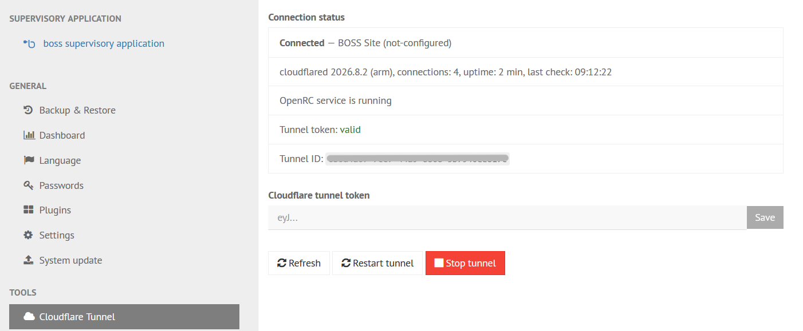

# Frigotehnica BOSS Cloudflare Tunnel

[](https://github.com/frxbg/frigotehnica-boss-cloudflare-tunnel/releases/latest)
[](https://github.com/frxbg/frigotehnica-boss-cloudflare-tunnel/actions/workflows/test.yml)

Install and manage Cloudflare Tunnel on CAREL BOSS and BOSS Micro systems.
The English management page integrates with Ajenti on port **8443**, using
the existing Ajenti login. No additional externally accessible management port
is needed. A password-protected standalone LAN panel is also available.

This project installs the official cloudflared client, an OpenRC tunnel service,
a management backend, and a separate service for scheduled cloudflared updates.
It supports **x86_64/amd64** and **ARMv7 hard-float** on Gentoo/OpenRC and
compatible Buildroot/OpenRC systems.

## Contents

- [Requirements](#requirements)
- [Install](#install)
- [Configure the site and update schedule](#configure-the-site-and-update-schedule)
- [Connect and publish BOSS](#connect-and-publish-boss)
- [Update](#update)
- [Uninstall](#uninstall)
- [Legacy CA commands](#legacy-ca-commands)
- [Services and files](#services-and-files)
- [Troubleshooting](#troubleshooting)
- [Release process](#release-process)

## Requirements

- Root access, or an account with sudo.
- ARMv7 hard-float or x86_64/amd64, with OpenRC.
- curl or wget, sha256sum, install, and standard POSIX utilities.
- Outbound HTTPS and connectivity to the Cloudflare Tunnel network.
- A remotely managed Cloudflare Tunnel connector token.
- Ajenti for integrated management; otherwise a trusted LAN for the standalone UI.

The curl commands below use sudo. The **Micro / wget** commands assume a root
terminal; add sudo before sh when running them as a non-root user.

For an outdated CA bundle, use the [release-specific legacy commands](#legacy-ca-commands)
instead of the normal HTTPS commands below.

## Install

The non-interactive installation is suitable for BOSS browser terminals.
It installs the components and lets you enter the token and site settings
through the management page afterwards.

### BOSS: curl

```sh
curl -fsSL https://github.com/frxbg/frigotehnica-boss-cloudflare-tunnel/releases/latest/download/install.sh -o /tmp/frigotehnica-install.sh && sudo sh /tmp/frigotehnica-install.sh --non-interactive --ajenti
```

### BOSS Micro: wget

```sh
wget -qO /tmp/frigotehnica-install.sh https://github.com/frxbg/frigotehnica-boss-cloudflare-tunnel/releases/latest/download/install.sh && sh /tmp/frigotehnica-install.sh --non-interactive --ajenti
```

The installer detects the architecture and Ajenti variant, verifies downloaded
files against pinned SHA-256 values, binds the backend to **127.0.0.1:9080**,
and installs the appropriate Ajenti plugin. It restarts Ajenti after the command
finishes; the browser session may disconnect briefly.

Open the usual Ajenti address on port **8443**, sign in, and select
**Tools → Cloudflare Tunnel**. If an old page remains visible, reload it after
Ajenti restarts.

### Standalone mode

Replace --ajenti with --no-ajenti in the installation command.
The installer detects the LAN address and prints a unique one-time password.
Open http://DEVICE_IP:9080 and replace that password at first login.
Use standalone HTTP access only on a trusted LAN.

### Installer options

Run sh install.sh --help for all options. Common options are:

| Option | Purpose |
| --- | --- |
| --ajenti | Require Ajenti integration and a loopback-only backend. |
| --no-ajenti | Install a standalone LAN panel. |
| --non-interactive | Avoid prompts; configure the token in the UI. |
| --auto-update-hours 48 | Set the cloudflared check interval at installation. |
| --no-auto-update | Disable scheduled cloudflared updates. |
| --enable-auto-update | Enable scheduled cloudflared updates. |
| --plugin-only | Replace only the Ajenti integration on an existing installation. |
| --no-start | Install without starting the tunnel, UI, or updater services. |
| --no-enable | Do not add the services to the boot runlevel. |

## Configure the site and update schedule

At the **bottom of the Cloudflare Tunnel page**, open **Site and automatic updates**.
The same settings are available in the native CAREL Ajenti view and the
standalone management page.

1. Enter **Site name**, for example Warehouse BOSS.
2. Enter **Public hostname**, for example boss.example.com, without https://,
   a port, or a path. Leave it empty until a hostname has been assigned.
3. Set **Check for cloudflared updates every (hours)**. Use 24 for daily
   checks, 48 for every two days, or 168 for weekly checks. The allowed range
   is 1–8760 hours.
4. Select or clear **Enable automatic cloudflared updates**.
5. Select **Save settings** and wait for **Settings saved.**

The status display uses the saved site name and hostname immediately.
Settings survive backend restarts and full project upgrades. Enabling automatic
updates also enables the updater at boot and starts it if needed.
A running updater reads a changed interval within one minute.

The hostname is a **display setting**. Saving it does not create a DNS record
or change a remotely managed Cloudflare Tunnel route. Configure that route
in Cloudflare as described below.

The default update schedule is every 24 hours. After an initial two-minute boot
delay, the updater checks the official Cloudflare latest stable release.
It installs only newer versions, verifies the download size, SHA-256, architecture,
and executable version, then replaces the binary atomically.

A running tunnel is restarted after an update; a stopped tunnel stays stopped.
If the updated process fails to start, the updater restores the previous binary
and attempts to start it again. This checks OpenRC process startup, not
end-to-end Cloudflare connectivity. An active tunnel may be interrupted briefly.

## Connect and publish BOSS

### Add the tunnel token

Create a remotely managed tunnel in the Cloudflare dashboard. From its connector
setup instructions, copy only the long token following --token, usually starting
with eyJ. The token is not an API token, Global API Key, Tunnel ID, or credentials JSON.

In **Tools → Cloudflare Tunnel**, paste it into **Cloudflare tunnel token**
and select **Save**. The backend validates and saves the token and starts or
restarts the tunnel service. The token is never displayed back to the browser.



See [Cloudflare’s tunnel setup guide](https://developers.cloudflare.com/cloudflare-one/networks/connectors/cloudflare-tunnel/get-started/create-remote-tunnel/).

### Publish the BOSS application

In the tunnel’s published application route, configure:

| Setting | Value |
| --- | --- |
| Public hostname | Your public BOSS hostname, for example boss.example.com. |
| Path | Leave empty to route the entire hostname, including APIs and upload endpoints. |
| Service type | HTTPS |
| Service URL | The BOSS device's LAN address and HTTPS port, for example 192.168.1.20:443. |
| No TLS Verify | Enable only when using the BOSS self-signed origin certificate. |
| HTTP Host Header | Your public BOSS hostname, for example boss.example.com, without a protocol, port, or path. |

Use the device's LAN HTTPS service as the origin and keep its address stable.
The service address is not the public hostname and does not include /boss/.
Users may open /boss/ in their browser, while other application endpoints can
use different paths on the same host.

When cloudflared runs on BOSS itself, an origin of 127.0.0.1 can cause BOSS to
select its local-device file dialog instead of a browser file chooser. The
inspected BOSS firmware explicitly checks for a loopback client address.
Use the LAN origin and public Host header, then verify the file chooser as
described under [upload troubleshooting](#boss-uploads-do-not-work-through-the-public-hostname).

Prefer a verified origin certificate when available. With a default self-signed
BOSS certificate on the origin connection, No TLS Verify affects only the
cloudflared-to-BOSS TLS check. It does not disable the public HTTPS certificate.
See [origin parameters](https://developers.cloudflare.com/tunnel/advanced/origin-parameters/)
and [HTTPS origin troubleshooting](https://developers.cloudflare.com/tunnel/troubleshooting/https-origins/).

Protect the public hostname with a Cloudflare Access policy appropriate to your
authorized users. Port 8443 is the administration interface; keep it restricted
to your administrative access path.

### Verify access

Select **Refresh** in Tunnel Control and confirm the expected Tunnel ID, a valid
token, and registered Cloudflare connections. In Cloudflare the tunnel should
be Healthy. Open the public hostname, sign in to BOSS, and check the application
features you need, including file uploads.

## Update

There are three separate update operations. **Automatic updates update only
cloudflared**, not the Frigotehnica UI or Ajenti plugin.

### Update the complete project

Run the [installation command](#install) again. It updates the UI, Ajenti plugin,
OpenRC services, and update helper. Existing token, authentication, saved site
settings, and update schedule are retained unless explicitly overridden.
Program and plugin backups are stored outside the Ajenti plugin search path.
A newer installed cloudflared is retained if the project bundle contains an
older version.

### Update cloudflared only

From an installation that includes the updater:

```sh
sh /opt/frigotehnica/update.sh
```

Or download the helper from the latest project release:

BOSS: curl

```sh
curl -fsSL https://github.com/frxbg/frigotehnica-boss-cloudflare-tunnel/releases/latest/download/update.sh -o /tmp/frigotehnica-update.sh && sudo sh /tmp/frigotehnica-update.sh
```

BOSS Micro: wget

```sh
wget -qO /tmp/frigotehnica-update.sh https://github.com/frxbg/frigotehnica-boss-cloudflare-tunnel/releases/latest/download/update.sh && sh /tmp/frigotehnica-update.sh
```

On an older installation without the updater, first run a full project update.

### Update the Ajenti plugin only

Use this when the backend is already compatible and only the plugin needs
replacing. New backend API features require a full project update.

BOSS: curl

```sh
curl -fsSL https://github.com/frxbg/frigotehnica-boss-cloudflare-tunnel/releases/latest/download/install.sh -o /tmp/frigotehnica-install.sh && sudo sh /tmp/frigotehnica-install.sh --plugin-only
```

BOSS Micro: wget

```sh
wget -qO /tmp/frigotehnica-install.sh https://github.com/frxbg/frigotehnica-boss-cloudflare-tunnel/releases/latest/download/install.sh && sh /tmp/frigotehnica-install.sh --plugin-only
```

This mode backs up and replaces only the detected Ajenti plugin. It does not
replace binaries, credentials, site settings, updater settings, or service files.

### Optional terminal controls

These duplicate the schedule controls available in the management page.
Run as root or prefix with sudo:

```sh
sh /opt/frigotehnica/update.sh --check
sh /opt/frigotehnica/update.sh --status
sh /opt/frigotehnica/update.sh --interval 48 --enable
sh /opt/frigotehnica/update.sh --disable
```

The first command checks availability without installing or restarting.
The second shows the saved schedule and latest update result.
The service retries a failed check at the next configured interval.

## Uninstall

BOSS: curl

```sh
curl -fsSL https://github.com/frxbg/frigotehnica-boss-cloudflare-tunnel/releases/latest/download/uninstall.sh -o /tmp/frigotehnica-uninstall.sh && sudo sh /tmp/frigotehnica-uninstall.sh
```

BOSS Micro: wget

```sh
wget -qO /tmp/frigotehnica-uninstall.sh https://github.com/frxbg/frigotehnica-boss-cloudflare-tunnel/releases/latest/download/uninstall.sh && sh /tmp/frigotehnica-uninstall.sh
```

The uninstaller stops and removes the tunnel, UI, and updater services and
removes the Ajenti plugin, UI binary, and helper. It retains cloudflared,
credentials, site and update settings, logs, and backups under /opt/frigotehnica.
It restarts the detected Ajenti service to remove the menu entry.

## Legacy CA commands

If curl reports an issuer-certificate error, or wget cannot verify GitHub’s
certificate, use the exact commands provided with the project release.

Open the [latest release](https://github.com/frxbg/frigotehnica-boss-cloudflare-tunnel/releases/latest)
and read its description or download its
[COMMANDS.md attachment](https://github.com/frxbg/frigotehnica-boss-cloudflare-tunnel/releases/latest/download/COMMANDS.md).
Each new release generates all five operations — install, project update,
cloudflared update, plugin-only update, and uninstall — in four variants:

- curl with sudo;
- Micro wget from a root terminal;
- curl with legacy CA handling;
- Micro wget with legacy CA handling.

Each command downloads a specific tagged script, checks its exact final SHA-256,
and executes it only if verification succeeds. Never reuse a digest from another
version. The installer also verifies its program assets and update helper.

Explicit legacy-CA installation sets legacy mode on a new updater configuration.
The initial pinned script hash can be checked against the release reference,
but upstream release metadata fetched later with TLS verification disabled is
not authenticated. SHA-256 still checks download integrity against that metadata.
After repairing the device’s CA bundle, restore normal verification:

```sh
sh /opt/frigotehnica/update.sh --strict-ca
```

## Services and files

OpenRC services:

```sh
rc-service cloudflared-frigotehnica status
rc-service frigotehnica-tunnel-ui status
rc-service frigotehnica-cloudflared-update status
```

Use start, stop, or restart instead of status as appropriate. Prefix commands
with sudo when required. Tunnel Control’s UI provides verified tunnel restart
and stop actions.

Main installed files:

```text
/opt/frigotehnica/cloudflared
/opt/frigotehnica/cloudflared.previous
/opt/frigotehnica/frigotehnica-tunnel-ui
/opt/frigotehnica/update.sh
/opt/frigotehnica/config/tunnel.token
/opt/frigotehnica/config/admin.auth
/opt/frigotehnica/config/ajenti-proxy.secret
/opt/frigotehnica/config/updates.json
/opt/frigotehnica/config/updates.json.status
/opt/frigotehnica/logs/
/opt/frigotehnica/backups/
```

The CAREL plugin is installed under /home/webui/pvshell-web/plugins/frigotehnica.
Generic Ajenti uses its detected site-packages directory. Prebuilt CAREL bundles
are included so the BOSS does not need frontend build tools.

Credentials and configuration files use restricted permissions. The CAREL
Ajenti worker receives only the access needed for the authenticated API proxy.
The UI cannot run arbitrary shell commands. Never commit tokens or passwords.

## Troubleshooting

### Ajenti menu or settings section is missing

Use a full project update when adding new backend features. Confirm that the
installer detected CAREL BOSS Ajenti and its plugin directory, then wait for the
detected Ajenti service to restart. Reload the browser page or sign out and in.
If the section still does not appear, inspect the Ajenti log and confirm that
the active plugin is in the directory used by that Ajenti process.

The plugin checks an authenticated Ajenti identity. Visibility and access also
depend on the permissions of the installed Ajenti/CAREL variant; it does not
create a separate Frigotehnica user account.

### Settings cannot be saved

Read the error next to Save settings. Site name must contain 1–100 characters;
the hostname must not include a protocol, port, or path; the interval must be an
integer from 1 to 8760 hours. A service configuration failure restores the
previous saved settings. Check that a full installation created the updater service.

### BOSS uploads do not work through the public hostname

First distinguish a **disabled upload button** from an upload request that
fails after clicking. A disabled button may reflect user permissions or a
failed prerequisite API request; it does not by itself establish a CORS error.
Compare local and public access with the same BOSS account.

One observed failure mode is a **Load from** dialog offering only a remote
archive, with no way to choose a file from the computer. In that state BOSS
rendered `fdLocal=true` and a read-only filename field instead of a browser
file input. Its JavaScript entered the local-device file dialog, so the upload
button stayed disabled because no suitable file could be selected.

For the site-configuration import screen, compare the server-rendered form:

| Field | Working browser upload | Observed local-device dialog |
| --- | --- | --- |
| `fdLocal` | `false` | `true` |
| `#sitebacupload` | Enabled `type="file"` input | Read-only `type="text"` input |
| `#uploadfrm5` encoding | `multipart/form-data` | `application/x-www-form-urlencoded` |

The compared installations served identical `FileDialog.js` and `system.js`
files. The difference was in the server-generated flags and form markup.
On the inspected firmware, `FileDialogBean.isLocal(HttpServletRequest)` checks
the client address, client hostname, and server name. In normal operation it
selects local mode for a client address of `127.0.0.1`, a client hostname of
`127.0.0.1`, a server name of `localhost`, or matching client and server names.
Changing the Host header alone cannot override the explicit loopback check.

For a tunnel connector running on BOSS, test the following published route:

1. Set the HTTPS service URL to that BOSS device's LAN address and port 443.
2. Set **HTTP Host Header** to its public hostname, without a protocol or path.
3. Save the route and sign in again through the public hostname. Reload the
   site-configuration import screen and compare its form with the table above.
4. Open the browser file chooser and cancel it to verify file selection safely.
   Do not restore a configuration archive merely to test the chooser.

The LAN-origin route still needs verification on each affected installation;
firmware customizations and forwarded-request handling can change the result.
If local mode remains, inspect those settings and the addresses BOSS actually
receives. Changing only `fdLocal` in the browser does not replace the already
rendered form and is not a persistent repair.

For request-address issues, inspect the browser Network and Console panels.
Check that the published route covers the whole hostname, not only /boss/.
Application and upload requests must reach the intended public HTTPS origin
and preserve their paths. A browser request to 127.0.0.1 or a private LAN IP
targets the client’s network, not the remote BOSS through the tunnel.

Check redirects and the Host header if BOSS generates a different address.
Cloudflare’s httpHostHeader option changes the request Host sent to the local
service; it does not rewrite absolute URLs already generated in the browser.
The public Host header above also prevents a matching local server name from
selecting local mode on the inspected firmware. See
[Cloudflare origin parameters](https://developers.cloudflare.com/tunnel/advanced/origin-parameters/).
The Site settings hostname field alone does not change BOSS upload behavior.

### The tunnel is running but not connected

Check the saved Tunnel ID and token, BOSS system time, default route, DNS,
outbound connectivity, and the current cloudflared log session.
See [Cloudflare Tunnel troubleshooting](https://developers.cloudflare.com/tunnel/troubleshooting/).

### Automatic updates fail

Read update.sh --status and /opt/frigotehnica/logs/cloudflared-update.log.
A failed download or checksum check leaves the existing binary in place.
Ensure that TLS certificates and the system clock are correct, the device can
reach the official GitHub release endpoints, and sufficient disk space is available.

## Release process

A version tag triggers GitHub Actions to:

1. Run Go, shell, installer, settings, and command-generation checks.
2. Build static Linux UI binaries for ARMv7 and x86_64.
3. Download the latest stable official cloudflared assets and verify their digests.
4. Pin program checksums, the helper checksum, and the exact release tag in the installer.
5. Generate SHA256SUMS from the final scripts and binaries.
6. Generate COMMANDS.md, a rendered README, and the release-description command block.
7. Publish the assets with the tagged release.

Generated command blocks are replaced rather than duplicated when a workflow is
rerun, and manually written release notes are preserved. The repository README
stays version-independent; exact legacy hashes belong to the release that
produced them. Review [CHANGELOG.md](CHANGELOG.md) for version history.

Run local checks with:

```sh
go test ./...
go vet ./...
python3 -m unittest discover -s scripts
```

## License

MIT — see [LICENSE](LICENSE). This independent community project is not
affiliated with or endorsed by CAREL or Cloudflare.
